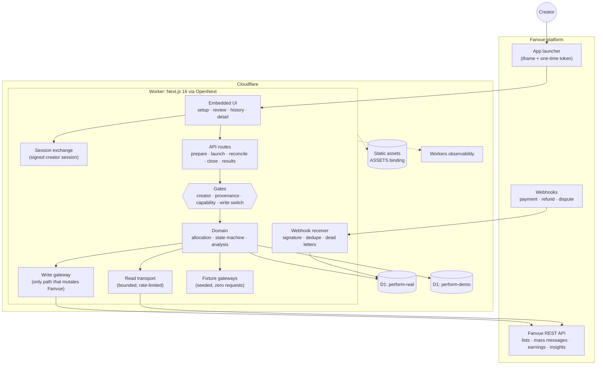
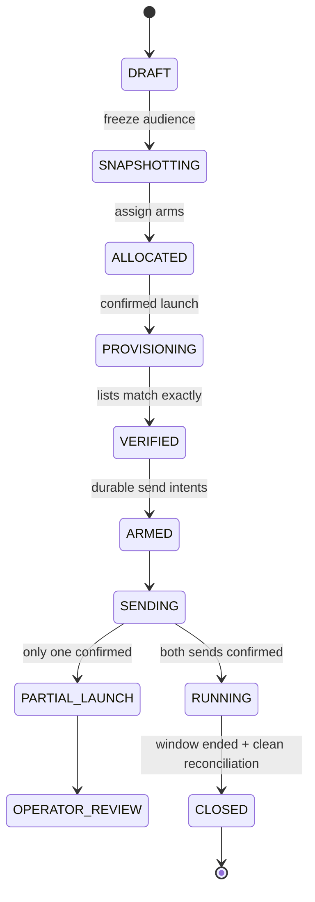

# Perform

**Perform helps Fanvue creators split one audience into two fair cohorts, test one change, and learn which offer performs better.**

It is an embedded Fanvue app for A/B testing paid (PPV) mass messages. A creator picks an audience and a Vault asset, writes two variants that differ in exactly one thing (copy or price), and Perform:

1. **Freezes the audience** and splits it deterministically into arms A and B.
2. **Provisions** one Fanvue custom list per arm and verifies its membership exactly.
3. **Schedules** both paid messages for the same delivery time.
4. **Observes** purchases, refunds and disputes through signed webhooks for a confirmed window (default 7 days).
5. **Reconciles** that evidence against Fanvue's earnings ledger and per-message totals.
6. **Closes** the experiment once the numbers agree, deletes the lists and freezes the result.

Every real effect sits behind server-side gates. A seeded workspace runs the same flow against fixtures and makes zero Fanvue requests.

## Try it

### Video walkthrough

A live A/B test of a paid mass message sent to real subscribers, followed by the results dashboard with demo data.

https://github.com/user-attachments/assets/2d8014f9-4b7b-4e16-aa76-fcf2f97d8459

- **Hosted preview:** [perform-fanvue.augur-2f4.workers.dev/preview](https://perform-fanvue.augur-2f4.workers.dev/preview). No Fanvue account, install or login needed.

Perform is an embedded Fanvue app: creators open it inside Fanvue, which signs them in. The hosted preview runs the same interface against seeded data, so it works in any browser and never contacts Fanvue.

A quick tour of the preview:

1. **Experiments.** The home page lists five seeded experiments, each built to show one outcome clearly: a decisive copy win, a price test with no dependable difference, a running test, a launch that stopped partway and an invalid comparison. Open **Specific preview copy** to see the verdict, both arms side by side, how certain the result is, and who converted, split by new and returning buyers. Open **Raise PPV to $15** to see how Perform reports a result that should not be acted on.
2. **Create A/B test.** Walk through the five setup steps: Audience, Asset, Question, Variants and Review. Variants enforce a single change, either copy or price.
3. **Review.** Shows the exact Fanvue actions a real launch would take, as a dry run. Nothing is sent from the preview.

The video covers the real embedded app inside Fanvue: a live launch, live results, reconciliation and close.

## Architecture



The REAL and DEMO workspaces are separate D1 databases, and every repository is scoped by creator and provenance, so seeded data cannot leak into real results and a seeded experiment can never reach the real gateway.

### Experiment lifecycle



Any non-terminal state can also move to `INVALID` (for example, a creator cancelling before delivery). Each transition needs typed evidence, such as the snapshot hash, list counts, intents or reconciliation, and the state machine rejects transitions without it.

## Keeping the data correct

| Concern | How Perform handles it |
| --- | --- |
| Fair, reproducible split | Stratified, hash-based allocation (FNV-1a, versioned algorithm) over a frozen, hashed audience snapshot. The same input always gives the same arms. |
| No duplicate side effects | List creation and member batches (≤100) are journaled before each request, and only the request whose insert claims an arm's list row may create that list, so concurrent retries cannot create a second one. An uncertain list create is never blindly retried. Sends use permanent idempotency keys (`<experimentId>:A` / `:B`); an uncertain send is read back before it is retried. |
| Recipients are exactly the assignment | Both custom lists are read back and must equal the frozen arms before anything is scheduled. |
| Both arms or neither | Both messages share one `scheduledAt`. If only one schedule confirms, Perform cancels it and moves the experiment to operator review; a failed cancellation is logged and named in the result, because that arm may still deliver. |
| Trustworthy purchase events | Webhooks are verified on the exact raw bytes, deduplicated by event ID, and anything unattributable is dead-lettered rather than dropped. |
| Attribution | Purchases are attributed by frozen assignment and send window by default; message-UUID matching is only enabled after a real purchase proves it. |
| Numbers that agree | Reconciliation compares webhook totals with Fanvue's earnings ledger and its own per-message purchase totals, flags missing assignments, orphan refunds and unreadable rows, and appends an immutable snapshot. |
| Honest close | Close lists every blocker (window still open, reconciliation missing, incomplete or mismatched). Only then does it delete both lists and freeze metrics; list deletions are journaled, so a retry is safe. |
| Nothing goes live by accident | `PERFORM_WRITE_MODE` must be `enabled`, and each live capability must be configured, granted by OAuth scope and verified against Fanvue's contract, recorded in append-only tables. Since ADR 0022 a verified capability is active for every installed creator unless that creator is switched off. Every Fanvue write, including cancellation, passes the same gate. |
| Honest results | Results use exact assigned denominators and settled revenue net of refunds. Copy tests use a Beta-Binomial posterior over distinct converted fans; price tests use a fixed-seed bootstrap of revenue per recipient. A direction counts as dependable only at 95% and above a minimum volume, and small cohorts are suppressed. Live experiments currently show descriptive counts without that analysis (see Known limits). |

## Stack

- **Runtime:** Cloudflare Workers, Next.js 16 (App Router) through OpenNext, React 19
- **Storage:** Cloudflare D1 (SQLite), two databases, SQL migrations in `migrations/`
- **Fanvue:** `@fanvue/builder-sdk` for the embedded session; REST API version `2025-06-26`
- **Tests:** Vitest with a migrated in-memory SQLite stand-in for D1

## Repository layout

```text
src/
  app/            Next.js routes: embedded UI, /preview harness, /api/*
  domain/         allocation, experiment state machine, observation window
  experiments/    setup contracts, review, dry-run plan, seeded audiences
  integrations/   Fanvue read/write transports and response parsers
  live/           gated entry points: capture, launch, ingestion, reconcile, close
  persistence/    D1 repositories (creator- and provenance-scoped)
  results/        analysis and audience evidence
migrations/       D1 schema
```

## Running it locally

Requires Node 22.5 or newer (the tests use Node's built-in SQLite) and pnpm 10.

```bash
pnpm install
pnpm dev
```

Then open `http://localhost:3000/preview`. The preview needs no Fanvue account, Cloudflare account, database or `.env.local`.

`/embedded` is the real app. It only works when opened from Fanvue, with the values from `.env.example` set and the D1 databases migrated.

Checks:

```bash
pnpm test
pnpm exec tsc --noEmit
pnpm lint
pnpm build
```

Deploying (owner only) uses `pnpm cf:deploy`, and migrations use `pnpm exec wrangler d1 migrations apply perform-real --remote` (and `perform-demo`).

## Status

Deployed at `https://perform-fanvue.augur-2f4.workers.dev`. The first real experiment launched on 22 October 2026, with both arms scheduled and delivered. Launch, the observation window, live results, reconciliation and close are built. Any creator who installs the app can use it: capabilities activate automatically once Fanvue's API contract has been verified, and payment webhooks are stored for the creator they name (ADR 0022).

### Known limits and next steps

- **Launch runs inside one request.** Provisioning and sending happen in the user's HTTP request. At large audiences (about 1,000 list batches per 100k fans) this should move to Cloudflare Queues or Workflows, with the route only enqueuing and each step retried with backoff and `Retry-After` handling.
- **Live results are descriptive.** Real experiments show counts and rates per arm; the Bayesian analysis and evidence gates run on seeded results only. Closed results are recomputed from stored evidence rather than snapshotted at close, so a late refund can still change them.
- **Reconciliation can block close.** The per-message check compares against Fanvue's lifetime totals, so purchases after the window can block close. It needs a tolerance or should become a warning.
- **Sessions.** The SDK session token carries the Fanvue tokens for its lifetime. Production would keep them server-side, encrypted, behind a short-lived session.
- **Operations.** Scheduled reconciliation, a sweeper for stuck states, alerting for failed or missing webhooks, an operator tool to resolve operator review, and webhook secret rotation.
