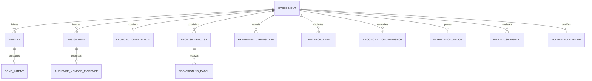
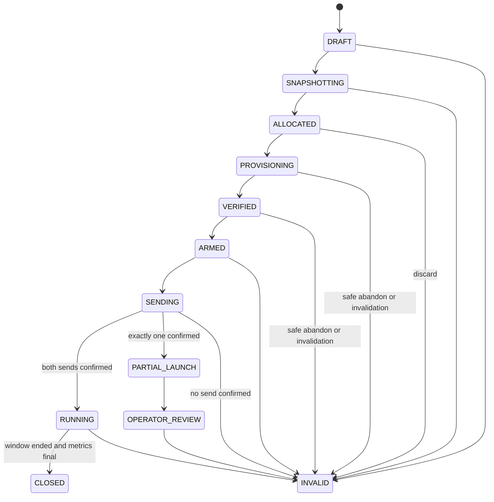

# Domain and persistence invariants

These rules are independent of the current D1 repository implementation. A
replacement store must preserve them.

## Data model

`PERFORM_REAL_DB` and `PERFORM_DEMO_DB` have the same schema but separate data.
Every repository is scoped to one creator and one provenance. The provenance
column remains defence in depth and is never accepted from an untrusted client.

## Experiment definition

- An experiment has a stable ID and a trimmed display name of 1–120 characters.
- Exactly two variants, A and B, must exist before snapshotting.
- A copy test changes only copy. A price test changes only price. Currency and
  media remain identical across arms.
- The source audience and variants become immutable when snapshotting begins.
- History ordering is `updated_at` descending, `created_at` descending, then ID
  ascending.

## Snapshot and allocation

- A complete snapshot has a capture time, SHA-256 hash, eligible count and
  allocation algorithm version.
- The hash covers canonical sorted `(fan UUID, stratum)` pairs. Source order and
  identical duplicates do not change it; one UUID in two strata is an error.
- `(experiment_id, fan_uuid)` is unique. The two arms are disjoint and their
  union equals the full eligible snapshot.
- Allocation is balanced independently within each stratum; arm sizes differ by
  at most one per stratum.
- `fnv1a-stratified-alternating-v2` is persisted with the snapshot. A new
  algorithm requires a new version.
- Assignment chunks are retryable staging work. `ALLOCATED` is committed only
  after total, arm counts, snapshot hash and algorithm version agree.

Audience evidence is captured before assignment and is immutable. It stores
stable UUIDs, subscription cohort and lineage flags, and prior reversal-adjusted
purchase facts—never names, handles, email addresses, avatars or copied
profiles. A missing, forbidden or malformed enrichment result fails the capture;
it is not silently converted to zero.

## Lifecycle

`CLOSED` and `INVALID` are terminal. Every invalidation records a reason.
Repeating a command with the same command ID is a no-op, not a self-transition.
A partial launch can never become a valid result.

## Recovery rules

- **Resume:** only `ALLOCATED` experiments can reopen at review. Rebuilding the
  review must reproduce the stored arms and snapshot hash exactly.
- **Discard:** `DRAFT`, `SNAPSHOTTING` and `ALLOCATED` may become `INVALID`
  when no external effect needs cleanup. Discard is idempotent.
- **Abandon:** only `PROVISIONING` and `VERIFIED` may use automated cleanup. It
  refuses uncertain list creation and any existing send intent. Known lists are
  deleted and journaled before invalidation.
- **Cancel:** a scheduled launch may be cancelled before delivery. Confirmed
  messages are cancelled, lists are deleted and the experiment is invalidated.
- **Close:** only a running experiment with an ended observation window and a
  complete, discrepancy-free reconciliation can close. Known lists are deleted
  before the terminal transition.

## External-effect invariants

- D1 and Fanvue never share a transaction. Persist intent before making the
  external request, then record the outcome.
- Custom-list creation is not automatically repeated after an uncertain
  response because that could create a duplicate list.
- Member additions are journaled in batches of at most 100 UUIDs and may replay
  the identical request.
- Both lists are read back and must exactly match the frozen assignments.
- There is one immutable send intent per arm. `(experiment_id, arm)` and
  `(creator_uuid, idempotency_key)` are independently unique.
- Send keys are permanently `<experimentId>:A` and `<experimentId>:B`. An
  uncertain retry reuses the stored key and byte-equivalent payload.
- Both messages use one scheduled time. Two confirmations are required for
  `RUNNING`; one confirmation enters operator review.
- `UNKNOWN` is a durable outcome, not an exception to hide.

## Commerce evidence and attribution

- `(source, event_id)` deduplicates webhook and seeded events; the payload hash
  detects reuse of an event ID with different content.
- One creator/payment ID can identify only one payment event.
- Reversals may arrive before payments and remain pending until the referenced
  payment exists.
- Dead letters keep identifiers and a payload hash, not the raw body.
- A payment counts only when its creator and attribution strategy place it in
  one experiment arm. Ambiguous candidates fail closed.
- The default strategy attributes broadcast payments by frozen assignment and
  observation window. Direct message matching requires an append-only proof.
- Reconciliation snapshots are append-only. A later read adds evidence; it does
  not overwrite earlier webhook evidence.

## Results and learning

- Copy tests use settled purchases per assigned recipient. Price tests use
  settled revenue per assigned recipient. The denominator never changes to
  views, deliveries or purchasers.
- Refunds and disputes remove settled purchases and revenue; gross values remain
  available for audit.
- Copy uncertainty uses a fixed-seed beta-binomial simulation with a Beta(1,1)
  prior. Price uncertainty uses a fixed-seed recipient bootstrap including
  zero-revenue recipients. Both expose 90% intervals.
- Evidence may be saved even when interpretation is blocked. A learning requires
  a closed, complete, fresh result that passes volume and confidence gates.
- Audience segments are descriptive, not separately randomised experiments.
  Segments below five assigned members suppress arm metrics and never receive
  automatic winner language.

## Transaction boundaries

| Boundary | Atomic in D1 | Recovery |
| --- | --- | --- |
| Create experiment and variants | Yes | Retry the complete create |
| Write one assignment chunk | Yes | Exact rows are idempotent |
| Finalise allocation | Yes | Counts, hash and version must match |
| Transition and transition record | Yes | Compare state; deduplicate command ID |
| Create two send intents | Yes | Unique arm and external-key constraints |
| Fanvue request and D1 outcome | No | Persist first; reconcile uncertainty |
| Record a commerce event | Yes | Source/event and payment constraints deduplicate |
| Append reconciliation | Yes | Never update an earlier snapshot |

## Retention status

The schema records intended fan-level and aggregate deletion deadlines, but the
repository does not yet implement an automated retention or deletion workflow.
The design defaults remain 90 days for identifiable fan-level rows after a
terminal state and 24 months for non-identifying aggregates, subject to product
and legal review. Do not describe those defaults as an operating policy until a
deletion job and verification evidence exist.

