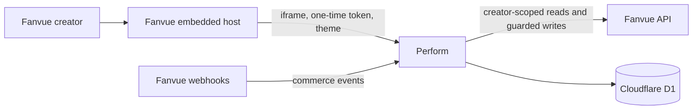
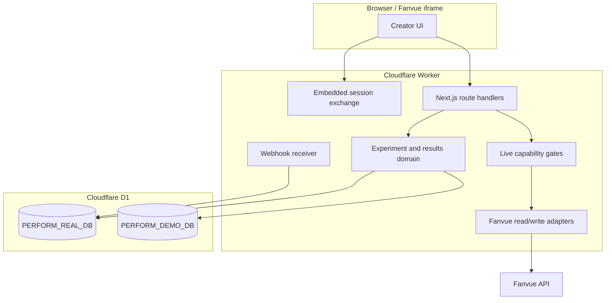

# Architecture overview

This document describes the system implemented in this repository. Architecture
decision records explain why these boundaries exist; the code and migrations are
the source of truth when a document falls behind.

## System context



Perform is a Next.js 16 App Router application deployed to one Cloudflare Worker
through OpenNext. It is primarily an embedded creator application, with a
standalone preview surface for deterministic demonstrations.

## Runtime boundaries



The browser never chooses its own identity, provenance, database binding, or
live capability. Route handlers derive those from a verified embedded session
and server configuration.

## Application layers

| Layer | Responsibility | Main locations |
| --- | --- | --- |
| UI | Setup, history, results, lifecycle actions and operator evidence | `src/app/embedded/` |
| API boundary | Session checks, workspace selection, request validation and response mapping | `src/app/api/` |
| Domain | State transitions, deterministic allocation and observation windows | `src/domain/` |
| Experiment application | Review construction, dry-run planning, saved experiment recovery | `src/experiments/` |
| Live application | Capture, launch, attribution, reconciliation, close and abandonment | `src/live/` |
| Fanvue adapters | Versioned API reads, writes and contract mapping | `src/integrations/fanvue/` |
| Persistence | Creator/provenance-scoped repositories and live-evidence stores | `src/persistence/` |
| Results | Projection, inference, audience evidence and learning gates | `src/results/` |

Domain and application modules depend on application-owned contracts. Fanvue
SDK and Cloudflare details stay at route, adapter and repository boundaries.

## Experiment flow

```mermaid
flowchart LR
    Define[Define A/B test]
    Capture[Freeze eligible audience]
    Allocate[Deterministically allocate A/B]
    Save[Save allocated experiment]
    Provision[Create and verify two custom lists]
    Schedule[Persist intents and schedule both messages]
    Observe[Observe purchases and reversals]
    Reconcile[Reconcile earnings and message totals]
    Close[Delete lists and close]

    Define --> Capture --> Allocate --> Save --> Provision --> Schedule --> Observe --> Reconcile --> Close
```



An allocated experiment may be reopened without recapturing its audience. The
server rebuilds the review from stored variants and assignments and refuses to
continue if the deterministic split or snapshot hash no longer matches.

Pre-send recovery is deliberately state-specific:

- an unlaunched `ALLOCATED` experiment can be discarded without a Fanvue call;
- a launch interrupted in `PROVISIONING` or `VERIFIED` can be abandoned only
  when every created list has a known identifier and no send intent exists;
- abandonment deletes known custom lists before marking the experiment invalid;
- uncertainty about list creation or any existing send intent requires operator
  review rather than automated cleanup.

## Real, demo and preview paths

Real and demo use the same domain contracts but different authorities and
storage:

- **Real** uses a verified Fanvue creator session, `PERFORM_REAL_DB`, live
  adapters, capability records and the write gate.
- **Demo** uses server-owned fixtures, `PERFORM_DEMO_DB` and fixture transports.
  Access is server-authorised for configured creator UUIDs or handles.
- **Preview** is a deterministic, D1-free presentation path for static fixtures.
- **Dry run** is not a workspace. It is an inspectable plan of the exact list,
  batching and send effects that would occur.

Objects and repository instances carry provenance. Demo identifiers are rejected
before a live adapter can issue a request.

## Live capability model

Live code existing is not sufficient authority to run it. Each capability moves
through this ladder:

```text
fixture_backed → configured → connected → verified → active
```

`configured` requires the capability and OAuth scopes in deployment config;
`connected` requires those scopes in the verified session; `verified` requires
append-only Phase X evidence; and `active` requires an explicit append-only owner
decision. Real writes additionally require `PERFORM_WRITE_MODE=enabled`.

The implemented capabilities are audience discovery, subscriber state, purchase
enrichment, commerce webhooks, earnings reconciliation, mass-message totals and
send. See [environment-contract.md](environment-contract.md) for the exact gates.

## Commerce and results

Verified live events and seeded fixture events share one `commerce_events`
shape and deterministic projection. Webhook delivery is treated as timely but
at-least-once and unordered; earnings reads and per-message totals provide the
manual reconciliation path.

The default purchase attribution strategy uses frozen assignment plus the
experiment observation window for broadcast purchases. Direct message-UUID
matching is available only after a recorded real-world proof establishes that
the payment identifier equals the mass-message identifier. Ambiguous payments
fail closed.

Results keep three concepts separate:

1. immutable evidence and arm totals;
2. observed direction and uncertainty; and
3. reusable audience learning, emitted only after integrity, completeness,
   freshness, volume and confidence gates pass.

## Operations deliberately not implemented

The current system has no queue, cron reconciliation, automatic close,
subscription-management service, secret rotation workflow, or dead-letter
alerting. Reconciliation and close are creator-triggered. Webhook destination
and secret lifecycle remain owner-operated. These are explicit operational gaps,
not hidden background behavior.

## Detailed references

- [Domain and persistence invariants](domain-and-persistence.md)
- [Environment and execution-mode contract](environment-contract.md)
- [Live-data operations](live-data-operations.md)
- [Architecture decision records](../adr/README.md)

